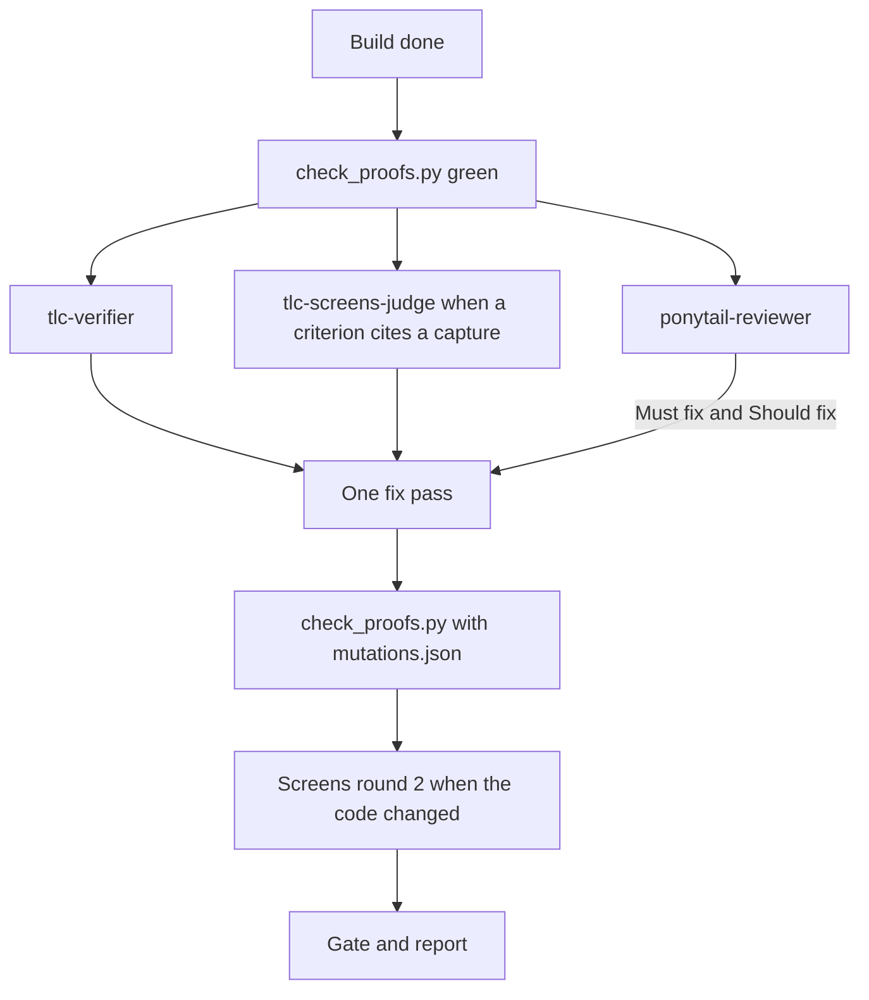

# tlc-ponytail

A Claude Code plugin that runs the [Tech Leads Club](https://github.com/tech-leads-club/agent-skills)
spec skills, `tlc-spec-lean` and `tlc-spec-driven`, with the independent agents they call for at the
end of a feature, plus a code review from [Ponytail](https://github.com/DietrichGebert/ponytail).

- **`tlc-verifier`**: the TLC Verifier. A fresh agent that did not build the feature checks the
  obligations, injects mutations and tries examples nobody named.
- **`tlc-screens-judge`**: the TLC screens sub-agent. It compares pictures of the running app with
  the binding captures.
- **`ponytail-reviewer`**: a Ponytail review of the same diff: bugs, risk, real load, missing tests,
  speed and code to cut.

The Verifier answers "did we build what the plan promised, and do the tests bite?". Ponytail answers
"is this code correct, safe and no bigger than it needs to be?". They run in parallel, and their
findings are fixed in one pass.

## Install

Ponytail first, then this plugin. In Claude Code, one command per prompt:

```
/plugin marketplace add DietrichGebert/ponytail
```
```
/plugin install ponytail@ponytail
```
```
/plugin marketplace add ATCamposs/tlc-ponytail
```
```
/plugin install tlc-ponytail@tlc-ponytail
```

Then start a new session. The TLC scripts need Python 3 and git.

## How a feature closes



A SessionStart hook adds a short rule, [`hooks/tlc-close.md`](hooks/tlc-close.md), so the session
dispatches these agents and folds the Ponytail findings into the fix pass:

- Must fix and Should fix join the single fix pass, each with its closing commit in
  `.specs/features/<feature>/ponytail-review.md`. Nice to have goes to the final report.
- An approved plan item counts as requested, so a review finding never cuts it. The plan's checks
  set the test bar; Ponytail's "one small test" is only the floor.

The TLC skills are copied unmodified. This plugin only adds the agents and that rule around them.

## Recommended: keep Ponytail's rules out of the judges

Ponytail injects its coding rules into every subagent. A judge should not carry the rules of the
code it judges, so restrict Ponytail with its own matcher in `~/.claude/settings.json`:

```json
{
  "env": {
    "PONYTAIL_SUBAGENT_MATCHER": "^(?!.*(tlc-verifier|tlc-screens-judge|ponytail-reviewer)).*$"
  }
}
```

Ponytail tests this regex, case-insensitive, against each subagent's type. This one lets every
subagent through except the three above.

## Models and language

The three agents run on `opus` (Opus 5.5) with `effort: medium`, set in their frontmatter in
[`agents/`](agents). In our use, that costs less than Sonnet 5.5 at `xhigh` and returns about the
same results. They answer in the language of the prompt that dispatched them.

## Updating the TLC skills

`skills/` holds the upstream folders at the commit named in [`THIRD_PARTY.md`](THIRD_PARTY.md). To
update, replace both folders with the upstream ones at a newer commit, unmodified, record the new
commit there and bump the version in `.claude-plugin/plugin.json`.

## License

MIT for this plugin's own files: agents, hooks, manifests and docs. The TLC skills keep their own
licenses (skill text CC-BY-4.0, scripts MIT), and Ponytail is installed separately under MIT. See
[`THIRD_PARTY.md`](THIRD_PARTY.md).
